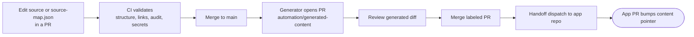

# CV Online Presenter Content

Owner-approved CV facts for the [`cv-online-presenter`](https://github.com/fredrik-hellmangroup/cv-online-presenter) app. The canonical public CV is `content/sources/master-cv.md` (approved under OQ-04). Do not add contact details, images or external profile links without separate approval. The synthetic example stays clearly labeled and draft-only.

The app pins one commit of this repository as its `content` submodule. That commit is the content revision for a build.

## Edit-to-website flow



A handoff signals a new content revision only. The app PR is reviewed and released separately.

## Local commands

Requires Node.js 24 and npm.

```powershell
npm ci
npm run validate
```

Before pushing generator changes, also run `npm run generate:validate-source`, `npm test` and `npm run generate:check`.

## Source ownership and generated pages

Edit the canonical source or `content/source-map.json`. Never hand-edit generated pages; change the source and regenerate. The generator writes a fixed allowlist of seven pages: `cv.md`, `home.md`, `services.md`, `projects.md`, and the Asira, Nordhem and Stockholmsmässan project pages. It never reads or generates `profile.md` or the contact/demo page. See [PROVENANCE.md](./PROVENANCE.md) for the section mapping and hashes.

Generation is fail-closed and journaled:

- `--write` and `--check` take an exclusive `.cv-generation.lock`. Do not run generation concurrently with another process that changes this workspace.
- Writes are journaled and atomic. A failed write rolls back, and the next `--write` recovers any interrupted transaction.
- Manual edits to generated output make `--check` and `--write` fail rather than be overwritten.

## Closed generated PRs

A stale generated-content PR (output now matches `main`) is commented on, closed, and its stable branch deleted automatically. Automation never reopens it. To resume a closed, unmerged PR, an authorized maintainer reviews it and dispatches `Generate public CV content PR` from `main` with `reopen_closed=true`. Without that input the PR stays closed.

## GitHub setup

Add the `generated-content` label before enabling automation.

| Environment | Secrets | GitHub App permissions | Restriction |
| --- | --- | --- | --- |
| `content-writer` | `CONTENT_WRITER_APP_ID`, `CONTENT_WRITER_APP_PRIVATE_KEY` | `contents: write`, `pull_requests: write`, installed only on this repository | `main` only; generator job only |
| `app-handoff` | `APP_HANDOFF_APP_ID`, `APP_HANDOFF_APP_PRIVATE_KEY` | `contents: write`, installed only on `fredrik-hellmangroup/cv-online-presenter` | `main` only; runs after the read-only merged-PR guard |

Principles:

- Keep `GITHUB_TOKEN` read-only. Grant write access only through the App tokens above.
- Do not use `pull_request_target`, and never expose writer credentials to pull-request jobs.
- Protect `main` with required checks. The content-writer App writes only the stable generated branch and never pushes to `main`.
- Do not use `GITHUB_TOKEN` for cross-repository dispatch.

## Troubleshooting

| Symptom | Action |
| --- | --- |
| Source or map validation fails | Fix the source headings or mapping metadata, then rerun the content PR checks. `--validate-source` checks only source and mapping. |
| Bootstrap hash mismatch | Stop. Verify the baseline pages and mapping. Do not replace hashes to force a write. |
| Generated-output conflict | Regenerate from the canonical source and mapping. Do not edit generated pages. `--write` refuses to overwrite manual edits. |
| Stale `.cv-generation.lock` | Confirm that no generation process is running, delete that exact file, then rerun. The generator never removes a lock automatically. |
| Pending transaction journal | Run `npm run generate:write`. It recovers the interrupted transaction before writing. |
| Generated PR is closed and unmerged | Inspect it. Dispatch with `reopen_closed=true` only if it should resume and output still differs from `main`. |
| App token or dispatch fails | Check the App installation, environment secrets, permissions and the `generated-content` label. Rerun after fixing setup. |

A successful handoff signals a content revision only. The app PR still needs review, and release is a separate manual step.

MIT licensed. See [LICENSE](./LICENSE).
